# MASAR — Database Schema (Revision 2: complete-project scope; design only, not yet applied)

> **Revision 2 changes.** Rebuilt for the full 19-track platform: track categories and relations; all 17 track content items stored as data; several roadmaps per track; a full resource model with verification; practical projects; labs shared across tracks; admin audit log and bulk-import jobs. Legend: **[Confirmed]** = in the owner's brief, **[Recommended]** = my proposal. Everything structural below is a **recommendation** derived from the confirmed requirements.

**Status:** design document. No SQL has been run. DDL snippets are reference material for the implementation milestones.
**Engine:** PostgreSQL on Supabase. **Companion:** `TECHNICAL_ARCHITECTURE.md` §7 and §10.

---

## 1. Conventions

- Primary keys: `uuid` with `default gen_random_uuid()`, except lookup tables and join tables (natural/composite keys).
- Every table has `created_at timestamptz not null default now()`; mutable ones also have `updated_at` (maintained by trigger). Omitted below for brevity.
- Bilingual content uses paired columns `*_en` / `*_ar` (both `NOT NULL` for published content).
- Content tables have `is_published boolean not null default false` and `sort_order int`.
- `CHECK` constraints enforce enums as `text` (easier to evolve than Postgres enum types).
- **RLS is enabled on every table.** Policies are listed in §6.
- Entities added beyond the brief's entity list (all **[Recommended]**): `governorates`, `user_roles`, `track_categories`, `track_category_map`, `track_relations`, `track_responsibilities`, `track_prerequisites`, `track_roles`, `track_projects`, `roadmap_tasks`, `stage_resources`, `resource_skills`, `resource_checks`, `resource_reports`, `lab_options`, `lab_option_keys`, `lab_answers`, `lab_tracks`, `user_roadmaps`, `quiz_attempts`/`quiz_answers`/`quiz_recommendations` (the normalized "Quiz Results"), `xp_events`, `opportunity_tracks`, `content_audit_log`, `import_jobs`. Each exists to meet a confirmed requirement (many tracks, categories, multiple roadmaps, resources per stage, admin-managed content).

---

## 2. Entity-relationship overview

```mermaid
erDiagram
  auth_users ||--|| profiles : has
  auth_users ||--o{ user_roles : has
  governorates ||--o{ profiles : lives_in
  track_categories ||--o{ track_category_map : groups
  career_tracks ||--o{ track_category_map : belongs_to
  career_tracks ||--o{ track_relations : relates
  career_tracks ||--o{ track_responsibilities : has
  career_tracks ||--o{ track_prerequisites : requires
  career_tracks ||--o{ track_roles : leads_to
  career_tracks ||--o{ track_projects : suggests
  career_tracks ||--o{ track_skills : requires
  skills ||--o{ track_skills : used_by
  career_tracks ||--o{ roadmaps : has
  roadmaps ||--o{ roadmap_stages : contains
  roadmap_stages ||--o{ roadmap_tasks : contains
  roadmap_stages ||--o{ stage_resources : lists
  learning_resources ||--o{ stage_resources : used_in
  learning_resources ||--o{ resource_skills : teaches
  skills ||--o{ resource_skills : taught_by
  learning_resources ||--o{ resource_checks : checked_by
  learning_resources ||--o{ resource_reports : reported_in
  quiz_questions ||--o{ quiz_options : offers
  profiles ||--o{ quiz_attempts : takes
  quiz_attempts ||--o{ quiz_answers : records
  quiz_attempts ||--o{ quiz_recommendations : produces
  career_tracks ||--o{ quiz_recommendations : recommended_in
  profiles ||--o{ user_interests : follows
  profiles ||--o{ user_roadmaps : enrolls
  roadmaps ||--o{ user_roadmaps : enrolled_in
  labs ||--o{ lab_tracks : serves
  career_tracks ||--o{ lab_tracks : has
  labs ||--o{ lab_scenarios : contains
  lab_scenarios ||--o{ lab_options : offers
  lab_options ||--|| lab_option_keys : graded_by
  profiles ||--o{ lab_attempts : runs
  lab_attempts ||--o{ lab_answers : records
  profiles ||--o{ user_task_progress : completes
  roadmap_tasks ||--o{ user_task_progress : completed_as
  profiles ||--o{ xp_events : earns
  achievements ||--o{ user_achievements : unlocked_as
  profiles ||--o{ user_achievements : unlocks
  opportunities ||--o{ opportunity_tracks : relates_to
  career_tracks ||--o{ opportunity_tracks : relates_to
  profiles ||--o{ bookmarks : saves
```



## 3. Tables

Notation: `column type [constraints]`. **PK** primary key, **FK** foreign key.

### 3.1 Identity and access

**governorates** _(lookup, public)_

```
code        text  PK              -- e.g. 'beheira'
name_en     text  NOT NULL
name_ar     text  NOT NULL
```

**user_roles** _(private; separate from profiles so users cannot promote themselves)_

```
user_id     uuid  PK, FK → auth.users(id) ON DELETE CASCADE
role        text  NOT NULL CHECK (role IN ('admin'))   -- absence of a row = regular user
granted_at  timestamptz NOT NULL DEFAULT now()
```

**profiles** _(private, one per user)_

```
id             uuid  PK, FK → auth.users(id) ON DELETE CASCADE
display_name   text  NOT NULL CHECK (char_length(display_name) BETWEEN 1 AND 60)
avatar_url     text
language       text  NOT NULL DEFAULT 'en' CHECK (language IN ('en','ar'))
theme          text  NOT NULL DEFAULT 'dark' CHECK (theme IN ('dark','light'))
governorate    text  FK → governorates(code) ON DELETE SET NULL
education      text  CHECK (education IN ('student','graduate','self_learner','other'))
current_track  uuid  FK → career_tracks(id) ON DELETE SET NULL
```

### 3.2 Track catalog and content _(public when published; admin-managed)_ **[Confirmed need, Recommended design]**

Track content is **data**. React components render these tables; adding a track or editing its text never needs a code change.

**track_categories**

```
id           uuid PK
slug         text NOT NULL UNIQUE
name_en, name_ar          text NOT NULL
description_en, description_ar text
icon         text
sort_order   int NOT NULL DEFAULT 0
is_published boolean NOT NULL DEFAULT false
```

**career_tracks** _(content items 1, 3, 4, 10 and metadata)_

```
id             uuid PK
slug           text NOT NULL UNIQUE
name_en, name_ar               text NOT NULL
intro_en, intro_ar             text NOT NULL      -- beginner-friendly introduction
overview_en, overview_ar       text NOT NULL      -- what professionals actually do
coding_percent smallint NOT NULL CHECK (coding_percent BETWEEN 0 AND 100)
difficulty     smallint NOT NULL CHECK (difficulty BETWEEN 1 AND 3)   -- 1 beginner, 2 intermediate, 3 advanced
est_weeks      smallint NOT NULL CHECK (est_weeks > 0)
r,i,a,s,e,c    smallint NOT NULL CHECK (value BETWEEN 0 AND 5)        -- RIASEC profile (draft values in TRACK_CATALOG.md)
status         text NOT NULL DEFAULT 'draft' CHECK (status IN ('draft','in_review','published','archived'))
sort_order     int NOT NULL DEFAULT 0
```

A database function `publish_track(id)` enforces the **publish gate** (`TRACK_CATALOG.md` §8) before status can become `published`.
Index: `(status, sort_order)`.

**track_category_map** _(supports more than one category per track)_

```
track_id     uuid FK → career_tracks(id) ON DELETE CASCADE
category_id  uuid FK → track_categories(id) ON DELETE CASCADE
is_primary   boolean NOT NULL DEFAULT false
PK (track_id, category_id)
UNIQUE (track_id) WHERE is_primary          -- exactly one primary category
```

**track_relations** _(content item 17: related career paths)_

```
from_track  uuid FK → career_tracks(id) ON DELETE CASCADE
to_track    uuid FK → career_tracks(id) ON DELETE CASCADE
relation    text NOT NULL CHECK (relation IN ('specialization_of','leads_to','adjacent','overlaps'))
note_en, note_ar  text
PK (from_track, to_track, relation)
CHECK (from_track <> to_track)
```

**track_responsibilities** _(item 5)_

```
id        uuid PK
track_id  uuid NOT NULL FK → career_tracks(id) ON DELETE CASCADE
position  smallint NOT NULL
text_en, text_ar  text NOT NULL
UNIQUE (track_id, position)
```

**skills** _(items 6, 7, 8)_

```
id        uuid PK
slug      text NOT NULL UNIQUE
name_en   text NOT NULL
name_ar   text
kind      text NOT NULL CHECK (kind IN ('technical','soft','tool'))
```

**track_skills**

```
track_id    uuid FK → career_tracks(id) ON DELETE CASCADE
skill_id    uuid FK → skills(id) ON DELETE CASCADE
importance  smallint NOT NULL DEFAULT 2 CHECK (importance BETWEEN 1 AND 3)
PK (track_id, skill_id)
```

Index: `(skill_id)`.

**track_prerequisites** _(item 9)_

```
id               uuid PK
track_id         uuid NOT NULL FK → career_tracks(id) ON DELETE CASCADE
skill_id         uuid FK → skills(id)
prereq_track_id  uuid FK → career_tracks(id)
note_en, note_ar text
is_required      boolean NOT NULL DEFAULT false      -- recommended, never a hard lock
CHECK (num_nonnulls(skill_id, prereq_track_id, note_en) >= 1)
```

**track_roles** _(item 16: career opportunities, i.e. job roles)_

```
id          uuid PK
track_id    uuid NOT NULL FK → career_tracks(id) ON DELETE CASCADE
title_en, title_ar  text NOT NULL
level       text NOT NULL CHECK (level IN ('entry','mid','senior'))
summary_en, summary_ar text
```

**track_projects** _(item 14: authored practical projects)_

```
id             uuid PK
track_id       uuid NOT NULL FK → career_tracks(id) ON DELETE CASCADE
stage_id       uuid FK → roadmap_stages(id) ON DELETE SET NULL
title_en, title_ar          text NOT NULL
brief_en, brief_ar          text NOT NULL
deliverable_en, deliverable_ar text NOT NULL
acceptance_en, acceptance_ar   text
difficulty     smallint NOT NULL CHECK (difficulty BETWEEN 1 AND 3)
est_hours      smallint NOT NULL CHECK (est_hours > 0)
is_published   boolean NOT NULL DEFAULT false
```

### 3.3 Roadmaps and learning resources **[Confirmed need, Recommended design]**

**roadmaps** _(several per track: items 11 and 12)_

```
id            uuid PK
track_id      uuid NOT NULL FK → career_tracks(id) ON DELETE CASCADE
slug          text NOT NULL                            -- 'core', 'fast-track', ...
variant_en, variant_ar  text NOT NULL
version       int  NOT NULL DEFAULT 1
status        text NOT NULL DEFAULT 'draft' CHECK (status IN ('draft','in_review','published','archived'))
UNIQUE (track_id, slug, version)
```

Index: `(track_id, status)`.

**roadmap_stages**

```
id          uuid PK
roadmap_id  uuid NOT NULL FK → roadmaps(id) ON DELETE CASCADE
position    smallint NOT NULL CHECK (position > 0)
stage_type  text NOT NULL CHECK (stage_type IN ('concept','hands_on','project','checkpoint'))
title_en, title_ar   text NOT NULL
goal_en, goal_ar     text
outcomes_en, outcomes_ar text            -- "after this stage you can…"
prereq_en, prereq_ar     text            -- recommended before starting, never a hard lock
est_hours   smallint CHECK (est_hours > 0)
UNIQUE (roadmap_id, position)
```

**roadmap_tasks** _(progress is tracked per task)_

```
id          uuid PK
stage_id    uuid NOT NULL FK → roadmap_stages(id) ON DELETE CASCADE
position    smallint NOT NULL CHECK (position > 0)
title_en, title_ar  text NOT NULL
task_type   text NOT NULL CHECK (task_type IN ('read','video','exercise','practice','project','review'))
est_minutes smallint NOT NULL CHECK (est_minutes > 0)
xp          smallint NOT NULL DEFAULT 20 CHECK (xp >= 0)
primary_resource_id uuid FK → learning_resources(id) ON DELETE SET NULL
UNIQUE (stage_id, position)
```

Task ids stay stable across roadmap versions where the task is unchanged, so user progress survives updates.

**learning_resources**

```
id              uuid PK
title_en        text NOT NULL
title_ar        text
description_en  text NOT NULL
description_ar  text
url             text NOT NULL CHECK (url ~ '^https://')
provider        text NOT NULL
resource_type   text NOT NULL CHECK (resource_type IN
                  ('official_docs','video_course','article','interactive_platform','practical_project','certification'))
language        text NOT NULL CHECK (language IN ('en','ar','other'))
difficulty      smallint NOT NULL CHECK (difficulty BETWEEN 1 AND 3)
est_minutes     int CHECK (est_minutes > 0)
is_free         boolean
requires_account boolean
verification_status text NOT NULL DEFAULT 'candidate'
                  CHECK (verification_status IN ('candidate','in_review','verified','stale','broken','retired','rejected'))
verified_by     uuid FK → auth.users(id)
verified_at     timestamptz
last_reviewed   date
notes           text                       -- internal, admin-only column group
UNIQUE (url)
```

Rule: `verified_by` and `verified_at` must be non-null when `verification_status = 'verified'` (CHECK constraint). A resource can be published to users only when status is `verified` or `stale`.
Index: `(verification_status)`, `(language, difficulty)`.

**resource_skills** _(related skills)_

```
resource_id  uuid FK → learning_resources(id) ON DELETE CASCADE
skill_id     uuid FK → skills(id) ON DELETE CASCADE
PK (resource_id, skill_id)
```

**stage_resources** _(related roadmap stage: several resources per stage, a resource may serve several stages)_

```
stage_id     uuid FK → roadmap_stages(id) ON DELETE CASCADE
resource_id  uuid FK → learning_resources(id) ON DELETE CASCADE
position     smallint NOT NULL
is_core      boolean NOT NULL DEFAULT true       -- core vs optional
note_en, note_ar  text
PK (stage_id, resource_id)
```

**resource_checks** _(audit trail of human checks)_

```
id           uuid PK
resource_id  uuid NOT NULL FK → learning_resources(id) ON DELETE CASCADE
checked_by   uuid NOT NULL FK → auth.users(id)
checked_at   timestamptz NOT NULL DEFAULT now()
result       text NOT NULL CHECK (result IN ('ok','broken','changed','paywalled','unsuitable'))
http_status  smallint                           -- optional, from an automated link check
notes        text
```

Automated link checks may write rows with a system user, but **only a human check can set `verified`**.

**resource_reports** _(user reports of broken or outdated resources)_

```
id           uuid PK
resource_id  uuid NOT NULL FK → learning_resources(id) ON DELETE CASCADE
user_id      uuid NOT NULL FK → profiles(id) ON DELETE CASCADE
reason       text NOT NULL CHECK (reason IN ('broken_link','outdated','wrong_level','inappropriate','other'))
details      text
status       text NOT NULL DEFAULT 'open' CHECK (status IN ('open','resolved','dismissed'))
```

**resource_ratings** _(one rating per user per resource)_

```
user_id      uuid FK → profiles(id) ON DELETE CASCADE
resource_id  uuid FK → learning_resources(id) ON DELETE CASCADE
clarity, level_fit, practical  smallint NOT NULL CHECK (value BETWEEN 1 AND 5)
recommends   boolean NOT NULL
PK (user_id, resource_id)
```

**content_audit_log** _(who changed what, for all admin-managed tables)_

```
id          uuid PK
table_name  text NOT NULL
row_id      uuid NOT NULL
action      text NOT NULL CHECK (action IN ('insert','update','delete','publish','unpublish'))
actor_id    uuid FK → auth.users(id)
changed_at  timestamptz NOT NULL DEFAULT now()
diff        jsonb
```

**import_jobs** _(bulk import of tracks, resources, roadmaps)_

```
id          uuid PK
kind        text NOT NULL CHECK (kind IN ('resources','roadmap','tracks','opportunities'))
status      text NOT NULL CHECK (status IN ('uploaded','validated','failed','imported'))
created_by  uuid NOT NULL FK → auth.users(id)
summary     jsonb                         -- row counts and validation errors
```

### 3.4 Assessment

**quiz_questions**

```
id           uuid PK
position     smallint NOT NULL UNIQUE
kind         text NOT NULL CHECK (kind IN ('riasec','coding'))
prompt_en, prompt_ar  text NOT NULL
is_active    boolean NOT NULL DEFAULT true
```

**quiz_options**

```
id           uuid PK
question_id  uuid NOT NULL FK → quiz_questions(id) ON DELETE CASCADE
position     smallint NOT NULL
label_en, label_ar  text NOT NULL
w_r,w_i,w_a,w_s,w_e,w_c  smallint NOT NULL DEFAULT 0 CHECK (value BETWEEN 0 AND 3)
coding_affinity  numeric(3,2) CHECK (coding_affinity BETWEEN 0 AND 1)   -- only on 'coding' questions
UNIQUE (question_id, position)
```

Scoring weights are not secret, so this table is publicly readable.

**quiz_attempts** _(the brief's "Quiz Results", normalized)_

```
id              uuid PK
user_id         uuid NOT NULL FK → profiles(id) ON DELETE CASCADE
completed_at    timestamptz NOT NULL DEFAULT now()
score_r,score_i,score_a,score_s,score_e,score_c  int NOT NULL
coding_affinity numeric(3,2) NOT NULL
engine_version  text NOT NULL
params          jsonb NOT NULL          -- e.g. {"lambda":0.25}
```

Index: `(user_id, completed_at DESC)`.

**quiz_answers**

```
attempt_id   uuid FK → quiz_attempts(id) ON DELETE CASCADE
question_id  uuid FK → quiz_questions(id)
option_id    uuid NOT NULL FK → quiz_options(id)
PK (attempt_id, question_id)
```

**quiz_recommendations**

```
attempt_id     uuid FK → quiz_attempts(id) ON DELETE CASCADE
rank           smallint CHECK (rank BETWEEN 1 AND 3)
track_id       uuid NOT NULL FK → career_tracks(id)
fit_index      smallint NOT NULL CHECK (fit_index BETWEEN 0 AND 100)
reason         jsonb NOT NULL           -- codes, not prose: {"dims":["I","C"],"coding":{"user":0.5,"track":0.35}}
PK (attempt_id, rank)
```

**user_interests** _(the brief's "User Interests": tracks a user follows or is exploring)_

```
user_id      uuid FK → profiles(id) ON DELETE CASCADE
track_id     uuid FK → career_tracks(id) ON DELETE CASCADE
source       text NOT NULL CHECK (source IN ('quiz','manual','lab'))
is_current   boolean NOT NULL DEFAULT false
PK (user_id, track_id)
```

Partial unique index: one current track per user → `UNIQUE (user_id) WHERE is_current`.

**user_roadmaps** _(which roadmap variant a user follows, and where they chose to start)_

```
user_id      uuid FK → profiles(id) ON DELETE CASCADE
roadmap_id   uuid FK → roadmaps(id) ON DELETE CASCADE
start_level  text NOT NULL CHECK (start_level IN ('scratch','basics','prior'))
is_current   boolean NOT NULL DEFAULT false
enrolled_at  timestamptz NOT NULL DEFAULT now()
PK (user_id, roadmap_id)
```

Changing start level or roadmap never deletes `user_task_progress`.

### 3.5 Taster Labs

**labs**

```
id            uuid PK
slug          text NOT NULL UNIQUE
title_en, title_ar  text NOT NULL
est_minutes   smallint NOT NULL
is_published  boolean NOT NULL DEFAULT false
```

**lab_tracks** _(a lab can serve several tracks, e.g. phishing triage for SOC Analysis and Network Security; item 15)_

```
lab_id       uuid FK → labs(id) ON DELETE CASCADE
track_id     uuid FK → career_tracks(id) ON DELETE CASCADE
is_primary   boolean NOT NULL DEFAULT false
position     smallint NOT NULL DEFAULT 1       -- recommended order within the track
PK (lab_id, track_id)
```

**lab_scenarios** _(steps)_

```
id           uuid PK
lab_id       uuid NOT NULL FK → labs(id) ON DELETE CASCADE
position     smallint NOT NULL
prompt_en, prompt_ar  text NOT NULL
terminal_text text                -- optional monospace block (e.g. ipconfig output)
UNIQUE (lab_id, position)
```

**lab_options** _(public: what the user sees)_

```
id           uuid PK
scenario_id  uuid NOT NULL FK → lab_scenarios(id) ON DELETE CASCADE
position     smallint NOT NULL
label_en, label_ar  text NOT NULL
UNIQUE (scenario_id, position)
```

**lab_option_keys** _(PRIVATE: answer key and feedback; admin-only table)_

```
option_id    uuid PK, FK → lab_options(id) ON DELETE CASCADE
is_correct   boolean NOT NULL
feedback_en, feedback_ar  text NOT NULL
```

Rationale: in the prototype the answer flags ship inside the client bundle. Separating them lets RLS hide them; feedback is returned only by `submit_lab_answer`.

**lab_attempts**

```
id            uuid PK
user_id       uuid NOT NULL FK → profiles(id) ON DELETE CASCADE
lab_id        uuid NOT NULL FK → labs(id)
completed_at  timestamptz
score         smallint CHECK (score >= 0)
total         smallint CHECK (total >= 0)
enjoyed       text CHECK (enjoyed IN ('yes','somewhat','no'))
```

Index: `(user_id, lab_id)`.

**lab_answers** _(written only by `submit_lab_answer`)_

```
attempt_id   uuid FK → lab_attempts(id) ON DELETE CASCADE
scenario_id  uuid FK → lab_scenarios(id)
option_id    uuid NOT NULL FK → lab_options(id)
is_correct   boolean NOT NULL
PK (attempt_id, scenario_id)
```

### 3.6 Progress and gamification

**user_task_progress**

```
user_id       uuid FK → profiles(id) ON DELETE CASCADE
task_id       uuid FK → roadmap_tasks(id) ON DELETE CASCADE
completed_at  timestamptz NOT NULL DEFAULT now()
PK (user_id, task_id)
```

Completion is self-reported; the platform does not claim to verify that external content was watched.

**xp_events** _(added: makes XP idempotent and auditable; fixes the XP-farming bug found in the audit)_

```
id          uuid PK
user_id     uuid NOT NULL FK → profiles(id) ON DELETE CASCADE
source      text NOT NULL CHECK (source IN ('task','stage','quiz','lab','achievement'))
source_id   uuid NOT NULL
xp          smallint NOT NULL CHECK (xp >= 0)
UNIQUE (user_id, source, source_id)
```

Total XP = `sum(xp)` via the view `v_user_xp`.

**achievements** _(public)_

```
id           uuid PK
code         text NOT NULL UNIQUE      -- 'first_quiz','first_lab','first_stage'
name_en, name_ar, description_en, description_ar  text NOT NULL
icon         text NOT NULL
xp_reward    smallint NOT NULL DEFAULT 0
```

**user_achievements**

```
user_id         uuid FK → profiles(id) ON DELETE CASCADE
achievement_id  uuid FK → achievements(id) ON DELETE CASCADE
unlocked_at     timestamptz NOT NULL DEFAULT now()
PK (user_id, achievement_id)
```

### 3.7 Opportunities and bookmarks

**opportunities**

```
id              uuid PK
title           text NOT NULL
organization    text NOT NULL
type            text NOT NULL CHECK (type IN ('internship','training','scholarship','event'))
mode            text NOT NULL CHECK (mode IN ('online','onsite','hybrid'))
governorate     text FK → governorates(code)      -- NULL = nationwide / online
description_en, description_ar text
eligibility_en, eligibility_ar text
apply_url       text NOT NULL CHECK (apply_url ~ '^https://')
source_url      text NOT NULL
deadline        date
status          text NOT NULL DEFAULT 'draft' CHECK (status IN ('draft','review','published','archived'))
last_verified_at date NOT NULL
created_by      uuid FK → auth.users(id)
```

Indexes: `(status, deadline)`, `(governorate)`, GIN full-text index on `title` (English/simple config).

**opportunity_tracks** _(many-to-many)_

```
opportunity_id  uuid FK → opportunities(id) ON DELETE CASCADE
track_id        uuid FK → career_tracks(id) ON DELETE CASCADE
PK (opportunity_id, track_id)
```

**bookmarks** _(foreign keys preserved by using one nullable column per target)_

```
id              uuid PK
user_id         uuid NOT NULL FK → profiles(id) ON DELETE CASCADE
opportunity_id  uuid FK → opportunities(id) ON DELETE CASCADE
resource_id     uuid FK → learning_resources(id) ON DELETE CASCADE
CHECK (num_nonnulls(opportunity_id, resource_id) = 1)
UNIQUE (user_id, opportunity_id), UNIQUE (user_id, resource_id)
```

---

## 4. Relationships in plain language

- A **user** has one **profile**, optionally an admin **role**, many **quiz attempts**, **lab attempts**, **completed tasks**, **bookmarks**, and may follow several **roadmaps** (one marked current).
- A **category** groups **tracks** (a track has one primary category and may appear in others). Tracks relate to each other (specialization, leads-to, adjacent, overlaps).
- A **track** owns its descriptive content (responsibilities, prerequisites, roles, projects), skills, roadmaps, related labs, and related opportunities.
- A **roadmap** has **stages**; a stage has **tasks** (what the user ticks off) and **resources** (what the user studies). A resource can serve many stages and teaches many skills.
- A **quiz attempt** stores the answers, scores, and up to three **recommendations**.
- **Progress** is derived: tasks completed vs. tasks in the roadmap. XP is a ledger (`xp_events`); achievements unlock once per user.
- Every admin change is written to **content_audit_log**; bulk uploads are tracked in **import_jobs**.

---

## 5. Public vs. private data

| Class                                    | Tables                                                                                                                                                                                                                                                                                                                                                                                                                                                                                                                                           | Who can read                        |
| ---------------------------------------- | ------------------------------------------------------------------------------------------------------------------------------------------------------------------------------------------------------------------------------------------------------------------------------------------------------------------------------------------------------------------------------------------------------------------------------------------------------------------------------------------------------------------------------------------------ | ----------------------------------- |
| **Public content** (published rows only) | `track_categories`, `career_tracks`, `track_category_map`, `track_relations`, `track_responsibilities`, `track_prerequisites`, `track_roles`, `track_projects`, `skills`, `track_skills`, `roadmaps`, `roadmap_stages`, `roadmap_tasks`, `stage_resources`, `learning_resources` (verified or stale only; internal `notes` hidden), `resource_skills`, `quiz_questions`, `quiz_options`, `labs`, `lab_tracks`, `lab_scenarios`, `lab_options`, `achievements`, `governorates`, `opportunities` (published and not expired), `opportunity_tracks` | Everyone, including guests          |
| **Private to each user**                 | `profiles`, `quiz_attempts`, `quiz_answers`, `quiz_recommendations`, `user_interests`, `user_roadmaps`, `lab_attempts`, `lab_answers`, `user_task_progress`, `xp_events`, `user_achievements`, `bookmarks`, `resource_ratings`, `resource_reports` (own rows)                                                                                                                                                                                                                                                                                    | Only the owner (admins for support) |
| **Admin only**                           | `lab_option_keys`, `user_roles`, `resource_checks`, `content_audit_log`, `import_jobs`, draft/in-review/archived content, internal resource `notes`                                                                                                                                                                                                                                                                                                                                                                                              | Admins                              |

---

## 6. Row Level Security plan

`is_admin()` helper (security definer, fixed `search_path`):

```sql
create function public.is_admin() returns boolean
language sql stable security definer set search_path = '' as $$
  select exists (select 1 from public.user_roles where user_id = auth.uid() and role = 'admin');
$$;
```

| Table group                                                                               | SELECT                                                                                                                                     | INSERT / UPDATE / DELETE                                                                                     |
| ----------------------------------------------------------------------------------------- | ------------------------------------------------------------------------------------------------------------------------------------------ | ------------------------------------------------------------------------------------------------------------ |
| Public content                                                                            | `is_published = true` (or `status = 'published' AND (deadline IS NULL OR deadline >= current_date)` for opportunities) **or** `is_admin()` | `is_admin()` only                                                                                            |
| `profiles`                                                                                | `id = auth.uid()` or admin                                                                                                                 | insert via trigger on signup; update own row only (`id = auth.uid()`); no role fields exist here             |
| Personal tables (`user_interests`, `user_task_progress`, `bookmarks`, `resource_ratings`) | `user_id = auth.uid()`                                                                                                                     | own rows only (`with check (user_id = auth.uid())`); task progress is written through `set_task_completed()` |
| Attempts (`quiz_*`, `lab_*`)                                                              | own rows                                                                                                                                   | **no direct writes**; only `submit_quiz`, `start_lab_attempt`, `submit_lab_answer`, `complete_lab_attempt`   |
| `xp_events`, `user_achievements`                                                          | own rows                                                                                                                                   | **no direct writes**; only security-definer functions/triggers                                               |
| `lab_option_keys`, `user_roles`                                                           | admin only                                                                                                                                 | admin only (roles managed via SQL by the owner)                                                              |

Example policies:

```sql
alter table public.profiles enable row level security;
create policy "own profile read"   on public.profiles for select using (id = auth.uid() or public.is_admin());
create policy "own profile update" on public.profiles for update using (id = auth.uid()) with check (id = auth.uid());

alter table public.opportunities enable row level security;
create policy "public opportunities" on public.opportunities for select
  using ((status = 'published' and (deadline is null or deadline >= current_date)) or public.is_admin());
create policy "admin writes opportunities" on public.opportunities for all
  using (public.is_admin()) with check (public.is_admin());
```

Every `security definer` function must set `search_path = ''`, use fully-qualified names, and take `auth.uid()` as the user (never a user id passed by the client).

---

## 7. Server-side functions (RPC) and views

| Function                                                              | Purpose                                                                                                                                                                                                                                                                  |
| --------------------------------------------------------------------- | ------------------------------------------------------------------------------------------------------------------------------------------------------------------------------------------------------------------------------------------------------------------------ |
| `submit_quiz(p_answers jsonb)`                                        | Validates answers, computes scores and top-3 recommendations (§10.1 of the architecture doc), stores attempt + answers + recommendations, awards the "first discovery" achievement and quiz XP once. Returns the attempt id.                                             |
| `start_lab_attempt(p_lab_id uuid)`                                    | Creates an attempt for the current user.                                                                                                                                                                                                                                 |
| `submit_lab_answer(p_attempt uuid, p_scenario uuid, p_option uuid)`   | Records the choice and returns `{is_correct, feedback}` from the private key table. One answer per step per attempt.                                                                                                                                                     |
| `complete_lab_attempt(p_attempt uuid, p_enjoyed text)`                | Computes score, stores reflection, awards lab XP and the "first lab" achievement once.                                                                                                                                                                                   |
| `set_task_completed(p_task uuid, p_done boolean)`                     | Inserts/deletes the progress row; awards task XP once; awards stage XP/achievement once when a stage becomes complete.                                                                                                                                                   |
| `publish_track(p_track uuid)`                                         | Admin only. Checks the publish gate (all content items present in both languages, a published roadmap with 3+ stages, every stage has resources, all published resources verified, 1+ project, 3+ roles, reviewer recorded) and returns a list of failures or publishes. |
| `record_resource_check(p_resource uuid, p_result text, p_notes text)` | Admin only. Writes `resource_checks` and updates `verification_status`/`verified_by`/`verified_at` using the caller's identity (a person, never a script).                                                                                                               |
| `validate_import(p_job uuid)` / `apply_import(p_job uuid)`            | Admin only. Validates an uploaded file (required fields, https URLs, enums, known references, duplicates), then applies it inside one transaction.                                                                                                                       |
| `v_user_xp` (view)                                                    | Total XP per user from `xp_events`.                                                                                                                                                                                                                                      |
| `v_track_progress` (view)                                             | Completed vs. total tasks per user per roadmap.                                                                                                                                                                                                                          |

---

## 8. Triggers

- `auth.users` insert → create `profiles` row.
- `updated_at` maintenance on mutable tables.
- Optional: validate that a published roadmap has at least one stage, and a published lab has at least one scenario with exactly one correct option per scenario.

---

## 9. Indexes summary

`career_tracks(is_published, sort_order)` · `track_skills(skill_id)` · `roadmap_tasks(stage_id)` · `quiz_attempts(user_id, completed_at desc)` · `lab_attempts(user_id, lab_id)` · `user_task_progress(user_id)` · `xp_events(user_id)` · `opportunities(status, deadline)` · `opportunities(governorate)` · `opportunity_tracks(track_id)` · full-text index on `opportunities.title` · `career_tracks(status, sort_order)` · `roadmaps(track_id, status)` · `stage_resources(resource_id)` · `learning_resources(verification_status)`, `(language, difficulty)` · `track_relations(to_track)` · `resource_reports(status)` · `content_audit_log(table_name, row_id)`.

---

## 10. Seed data mapping from the approved prototype

| Prototype data                                                                     | Seeds into                                                                                                                                                                                             |
| ---------------------------------------------------------------------------------- | ------------------------------------------------------------------------------------------------------------------------------------------------------------------------------------------------------ |
| 6 tracks (Networking, Cybersecurity, Data Analysis, UI/UX, Web, Digital Marketing) | `career_tracks` rows for the **19-track catalog** (`TRACK_CATALOG.md`): Networking, Data Analysis, UI/UX, Web, Digital Marketing keep their values; the single Cybersecurity track is split into three |
| Track skills lists                                                                 | `skills`, `track_skills` (extended with `kind` and the soft/tool distinction)                                                                                                                          |
| 6 quiz questions with option weights                                               | `quiz_questions`, `quiz_options` (**to be expanded**, see architecture §10.1)                                                                                                                          |
| Networking lab (3 steps, feedback, correct flags)                                  | `labs`, `lab_scenarios`, `lab_options`, `lab_option_keys`, `lab_tracks`                                                                                                                                |
| 8 sample opportunities                                                             | `opportunities`, `opportunity_tracks` (marked as sample until verified)                                                                                                                                |
| Roadmap template (3 stages × 2 tasks)                                              | Placeholder rows only; real roadmaps are authored per track through the admin tools                                                                                                                    |
| 3 badges                                                                           | `achievements`                                                                                                                                                                                         |
| 5 governorates in the filter                                                       | `governorates` (extend to all governorates)                                                                                                                                                            |

Seed and sample data must be clearly flagged until the team replaces it with verified content. **No resource rows are seeded from memory:** every resource enters as `candidate` and is verified by a person.
