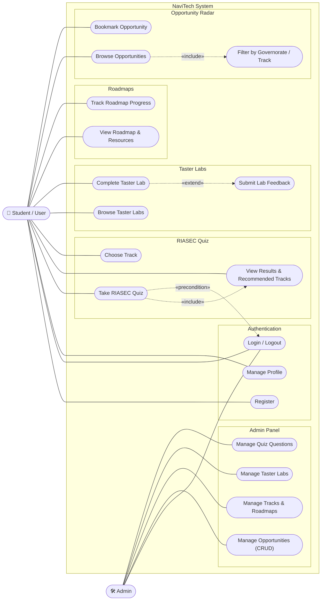
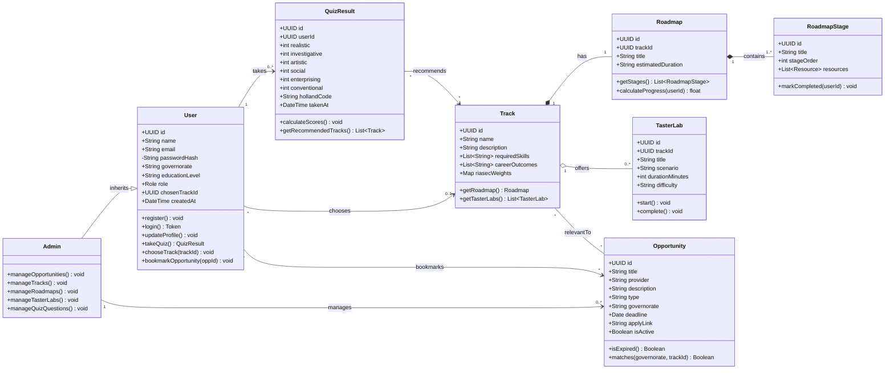

# NaviTech (مسار) — UML Design

> الرسومات مكتوبة بـ **Mermaid.js** وبتتعرض تلقائيًا على GitHub. ولو عاوز تعرضها في أي مكان تاني، الصقها في [mermaid.live](https://mermaid.live) وصدّرها كصورة.

---

## 1. Use Case Diagram

Mermaid مفيهوش نوع Use Case رسمي، فبنستخدم `flowchart` بشكل مرادف: الـ Actors برّه حدود النظام، والـ Use Cases جوّه (`System Boundary`).

### شرح الـ Use Case Diagram

| العنصر | التوضيح |
|---|---|
| **Student / User** | المستخدم المسجّل. بيعمل الكويز ويشوف الترشيحات ويجرب Labs ويتابع Roadmap ويتصفح الفرص. |
| **Admin** | مدير المحتوى. بيدخل ويعدل الفرص والتراكات والـ Roadmaps والـ Labs وأسئلة الكويز يدويًا. |
| **«include»** | علاقة إجبارية: أخذ الكويز يستدعي دايمًا عرض النتيجة. وتصفح الفرص بيتضمن إمكانية الفلترة. |
| **«extend»** | علاقة اختيارية: بعد إنهاء الـ Lab المستخدم **ممكن** يرسل Feedback، مش لازم. |
| **Login** | مشترك بين الـ Student والـ Admin، والصلاحيات بتتفرق بعدها بالـ Role. |

---

## 2. Class Diagram

> **ملحوظة:** أضفنا `TasterLab` و`RoadmapStage` فوق الكيانات الستة المطلوبة، لأنهم ضروريين لتمثيل Taster Labs وتفاصيل الـ Roadmap. لو عاوزه مبسط جدًا، تقدر تشيلهم وتحتفظ بالستة الأساسيين.

---

## 3. شرح العلاقات بين الـ Classes

### 3.1 جدول العلاقات

| العلاقة | النوع | الـ Multiplicity | التفسير |
|---|---|---|---|
| `Admin` ← `User` | **Inheritance** (Generalization) | — | الأدمن هو User بصلاحيات إضافية، فبيرث كل خصائصه (email, login, ...) ويضيف دوال الإدارة. |
| `User` → `QuizResult` | Association | 1 إلى 0..* | المستخدم الواحد ممكن يعمل الكويز أكتر من مرة، فيبقى عنده عدة نتائج (History). |
| `QuizResult` → `Track` | Association | * إلى * | نتيجة الكويز بتفرز عدة تراكات مرشحة، والتراك الواحد ممكن يظهر في نتايج ناس كتير. |
| `User` → `Track` | Association | * إلى 0..1 | المستخدم يختار تراك واحد كحد أقصى كـ Chosen Track، والتراك ممكن يختاره ناس كتير. |
| `Track` ◆— `Roadmap` | **Composition** | 1 إلى 1 | الـ Roadmap مالهاش معنى من غير التراك، ولو التراك اتمسح بتتمسح معاه. |
| `Roadmap` ◆— `RoadmapStage` | **Composition** | 1 إلى 1..* | المراحل جزء لا يتجزأ من الـ Roadmap. |
| `Track` ◇— `TasterLab` | **Aggregation** | 1 إلى 0..* | التراك بيضم عدة Labs، لكن الـ Lab ممكن يتنقل أو يتعاد استخدامه كمحتوى مستقل. |
| `Track` — `Opportunity` | Association | * إلى * | الفرصة الواحدة ممكن تناسب أكتر من تراك، والتراك عنده فرص كتير. |
| `User` → `Opportunity` | Association | * إلى * | عمل Bookmark: مستخدمين كتير ممكن يحفظوا نفس الفرصة. |
| `Admin` → `Opportunity` | Association | 1 إلى 0..* | الأدمن بيدخل ويدير الفرص يدويًا. |

### 3.2 تحويلها لجداول في قاعدة البيانات

علاقات **Many-to-Many** بتتحول لجداول وسيطة (Junction Tables):

- `quiz_result_tracks` (quiz_result_id, track_id, match_percentage)
- `opportunity_tracks` (opportunity_id, track_id)
- `user_bookmarks` (user_id, opportunity_id)
- `user_roadmap_progress` (user_id, stage_id, completed_at)

---

## 4. أسئلة متوقعة في السكشن (Q&A Prep)

**س1: ليه Admin بيرث من User؟**
لأن الأدمن في الأصل مستخدم مسجّل (بيسجل دخول ولديه بروفايل)، وبيضيف عليه صلاحيات إدارة. الوراثة بتمنع تكرار الكود. وفي التنفيذ الفعلي بنستخدم حقل `role` في جدول واحد (`users`) بدل جدولين.

**س2: إيه الفرق بين Composition و Aggregation عندكم؟**
الـ Composition (زي Track → Roadmap) يعني الجزء بيموت بموت الكل. الـ Aggregation (زي Track → TasterLab) يعني الجزء له وجود مستقل نسبيًا.

**س3: ليه QuizResult كلاس منفصل مش جزء من User؟**
لأن المستخدم ممكن يعيد الاختبار، فمحتاجين نحتفظ بالتاريخ. كمان ده بيفيد في Phase 2 لأن البيانات دي هتتحول لـ Dataset للـ AI.

**س4: إزاي النظام بيرشح التراكات؟**
كل Track عنده أوزان RIASEC (`riasecWeights`). بنحسب تطابق بين درجات المستخدم وأوزان التراك (مثلًا Cosine Similarity أو مجموع الأوزان)، ونرتب التراكات تنازليًا بنسبة التطابق. ده Rule-Based في Phase 1، ومعزول في Service مستقلة عشان نبدله بـ AI في Phase 2.

**س5: إزاي الفلترة بالمحافظة والتراك بتشتغل؟**
`Opportunity` فيها حقل `governorate`، وعلاقة Many-to-Many مع `Track`. الفلترة عبارة عن Query بشرط على المحافظة وJoin على جدول `opportunity_tracks`، مع Indexes على الحقول دي للأداء.

**س6: فين Taster Labs في الـ Use Case؟**
المستخدم بيتصفحها ويكملها (`Complete Taster Lab`)، وبعدها اختياريًا بيرسل Feedback (`extend`)، والنتيجة بتتسجل لتحسين الترشيحات مستقبلًا.

**س7: ليه استخدمتوا `flowchart` للـ Use Case؟**
لأن Mermaid ما بيدعمش Use Case Diagram رسمي. المحتوى مطابق لمعايير UML، ولو الدكتور طلب الشكل الكلاسيكي (بيضاوي + Stick Figure) نرسمه في Draw.io أو Figma بنفس الـ Actors والـ Use Cases.
